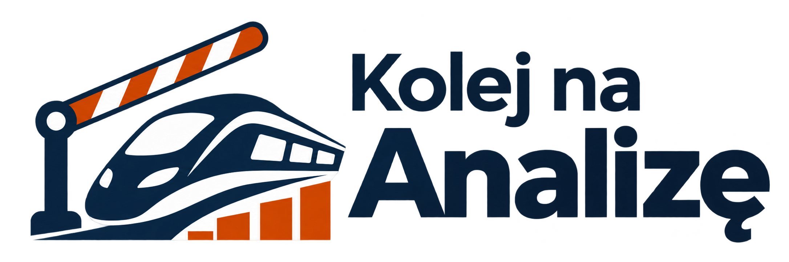

# Kolej na Analizę



**System analizy ekspozycji na ruch oraz priorytetów bezpieczeństwa przejazdów kolejowo-drogowych w Warszawie.**

Projekt edukacyjny przygotowywany do konkursu „Kolej na bezpieczeństwo”. Aplikacja lokalna (Docker Compose, FastAPI, PostGIS, Leaflet, Ollama/Qwen) ma łączyć dane kolejowe, drogowe i charakterystyki przejazdów, prezentować mapę, ranking oraz uzasadnienia wyników poprzez asystenta AI.

> Status: **ewidencja przejazdów, planowy ruch pociągów, pomiary ruchu drogowego ZDM, eksperymentalny ranking RPS z mapą i asystent AI na lokalnym modelu**. Nie traktować rankingów demonstracyjnych jako oficjalnych ocen ryzyka wypadku.

## Dokumentacja
- [Porównania, jakość danych i krótkie rozmowy](docs/ASSISTANT_CAPABILITIES.md)
- [Założenia i wymagania](docs/PROJECT_SPEC.md)
- [Architektura i model danych](docs/ARCHITECTURE.md)
- [Źródła danych, jakość i licencje](docs/DATA_SOURCES.md)
- [Kontrakt danych i migracje](docs/DATA_CONTRACT.md)
- [Metodyka oceny i walidacja](docs/ANALYSIS_METHOD.md)
- [Frontend i system wizualny](docs/FRONTEND_DESIGN.md)
- [Backlog i harmonogram](docs/BACKLOG.md)

## Uruchomienie lokalne
Wymagany Docker z Compose v2.

```bash
cp .env.example .env        # ustaw POSTGRES_PASSWORD
docker compose up -d --build
docker compose ps           # wszystkie usługi powinny być "healthy"
```

| Usługa | Adres (tylko 127.0.0.1) |
|---|---|
| Frontend | http://localhost:8080 |
| Backend, healthcheck | http://localhost:8765/api/v1/health |
| Backend, OpenAPI | http://localhost:8765/api/v1/docs |
| PostGIS | localhost:55432 (zmienna `POSTGIS_HOST_PORT`) |

Przy pierwszym uruchomieniu usługa `ollama-pull` pobiera model (`OLLAMA_MODEL`, kilka GB). Do tego czasu healthcheck zwraca `degraded`, a mapa i backend działają normalnie. Worker: `docker compose run --rm worker`.

### Zestaw demonstracyjny bez internetu (RSA-014)
Na **pustej** bazie jedno polecenie ładuje 11 fikcyjnych przejazdów (`DEMO-01` … `DEMO-11`) w trzech fikcyjnych dzielnicach, liczy ruch pociągów i ranking:

```
docker compose run --rm worker python -m app.worker load-demo
```

Nie wymaga sieci ani kluczy API. Aplikacja pokazuje wtedy bursztynowy pasek „DANE DEMONSTRACYJNE”, a ranking ma znacznik `is_demo`. Zestaw przechodzi przez te same funkcje importu i analizy co dane rzeczywiste, więc pokazuje działanie aplikacji, a nie stan sieci kolejowej. Danych fikcyjnych i rzeczywistych nie da się zmieszać: `load-demo` odmawia pracy na bazie z prawdziwymi przejazdami, a polecenia `import-*` — na bazie demonstracyjnej. Żeby mieć obie, użyj osobnego projektu Compose (osobny wolumen), np. `docker compose -p railsafe-demo ...` z innymi portami w `.env`.

### Import ewidencji przejazdów (RSA-004)
```bash
docker compose run --rm worker python -m app.worker import-crossings
```
Zadanie odczytuje przejazdy z warstwy UTK w Geoportalu, porównuje je z OpenStreetMap, zapisuje do PostGIS i tworzy raport `reports/DATA_AUDIT_crossings.md`. Wymaga dostępu do internetu; trwa kilka minut (kilkaset zapytań z krótkimi przerwami). Można je uruchamiać wielokrotnie. Jeśli serwery Overpass są niedostępne z kontenera, zadanie wypisze zapytanie do ręcznego wykonania na overpass-turbo.eu; zapisany wynik podaje się opcją `--osm-file /reports/osm.json`. Szczegóły: [DATA_SOURCES.md](docs/DATA_SOURCES.md).

### Import dzielnic, torów i dróg (RSA-005)
```bash
docker compose run --rm worker python -m app.worker import-topology
```
Uruchamiać po imporcie przejazdów. Pobiera granice dzielnic z PRG oraz tory i jezdnie z BDOT10k, przypisuje przejazdy do dzielnic, weryfikuje je geometrycznie i tworzy raport `reports/DATA_AUDIT_topology.md`.

### Import planowego ruchu pociągów (RSA-006/009)
```bash
docker compose run --rm worker python -m app.worker import-schedule
```
Uruchamiać po imporcie dzielnic i torów. Pobiera otwarty rozkład GTFS (bez klucza), liczy planowe pociągi pasażerskie na każdy przejazd w tygodniu odniesienia i tworzy raport `reports/DATA_AUDIT_trains.md`.

### Pomiary ruchu drogowego ZDM (RSA-007)
```bash
docker compose run --rm worker python -m app.worker import-road-counts
```
Uruchamiać po imporcie dzielnic i torów, przed `run-analysis`. Wybiera punkty systemu Automatycznych Pomiarów Ruchu ZDM leżące na ulicach przejazdów, zleca dla nich raporty natężenia (dni miarodajne, domyślnie ostatnie 28 dni), zapisuje średnie dobowe i profile godzinowe oraz tworzy raport `reports/DATA_AUDIT_road.md` z porównaniem pomiaru i modelu z klasy drogi. Przejazd z punktem na tej samej ulicy do 300 m dostaje w rankingu zmierzone natężenie zamiast szacunku. Źródło danych: Zarząd Dróg Miejskich w Warszawie. Bez dostępu do serwera ZDM można podać raport zapisany z przeglądarki: `--zdm-file /reports/zdm.json --day-type miarodajny`. Szczegóły: [DATA_SOURCES.md](docs/DATA_SOURCES.md).

### Pomiary ZDM na skrzyżowaniach (RSA-017)
```bash
docker compose run --rm worker python -m app.worker import-intersection-counts
```
Pobiera z publicznych warstw ArcGIS ZDM pomiary na 254 skrzyżowaniach (2023–2026) i przypisuje przejazdom najbliższe skrzyżowanie na tej samej ulicy do 300 m. Karta przejazdu pokazuje natężenie w szczycie (całe skrzyżowanie), udział ciężarówek i autobusów, pieszych i rowerzystów. Ranking się nie zmienia: to pomiary kilku godzin dla całego węzła. Raport: `reports/DATA_AUDIT_intersections.md`.

### Analiza priorytetów RPS (RSA-010)
```bash
docker compose run --rm worker python -m app.worker run-analysis
```
Uruchamiać po imporcie rozkładu. Liczy eksperymentalny wskaźnik RPS dla zweryfikowanych przejazdów drogowych, zapisuje przebieg w bazie i tworzy raport `reports/RPS_report.md`. Ranking i składniki są od razu widoczne w aplikacji. Metoda: [ANALYSIS_METHOD.md](docs/ANALYSIS_METHOD.md), sekcja 8.

### Asystent AI (RSA-013)
Głównym ekranem jest rozmowa z lokalnym modelem Qwen (Ollama), z historią w lewym panelu. Mapa otwiera się ręcznie lub przyciskiem „Pokaż na mapie” w odpowiedzi. Z karty przejazdu można dołączyć obiekt do kolejnego pytania. Historia, gałęzie i stan mapy są zapisywane wyłącznie w tej przeglądarce, bez logowania. Asystent odpowiada wyłącznie na podstawie danych aplikacji, pobieranych przez sześć bezpiecznych funkcji tylko do odczytu, i pokazuje, które dane sprawdził. Wymaga pobranego modelu (`OLLAMA_MODEL`, stan widać w panelu „Stan usług") oraz wykonanego `run-analysis`. Na samym procesorze odpowiedź trwa minuty; z kartą NVIDIA włącz dodatek `docker-compose.gpu.yml` (instrukcja w tym pliku i w `.env.example`). Szczegóły: [ARCHITECTURE.md](docs/ARCHITECTURE.md).

Schemat bazy tworzy przy starcie usługa `migrate` (`alembic upgrade head`). Cofnięcie migracji jest wyłącznie ręczne: `docker compose run --rm migrate alembic downgrade -1`.

Po wykonaniu obu importów (niżej) aplikacja pokazuje ewidencję przejazdów: mapę z kategoriami, granice dzielnic, filtry, listę i kartę przejazdu. Dane o ruchu, ranking i asystent AI są w kolejnych zadaniach [backlogu](docs/BACKLOG.md).

API ewidencji: `GET /api/v1/districts`, `GET /api/v1/crossings` (filtry `district_id`, `bbox`, `verification_status`, `category`, `limit`, `offset`) i `GET /api/v1/crossings/{id}`. Geometrie są zwracane jako GeoJSON w WGS84; domyślnie tylko przejazdy zweryfikowane w granicach Warszawy.

### Praca nad kodem
- Backend: `cd backend && pip install -r requirements-dev.txt && ruff check . && pytest`
- Testy migracji wymagają PostGIS i bazy o nazwie kończącej się na `_test`: `RAILSAFE_TEST_DB=1 POSTGRES_HOST=… POSTGRES_DB=railsafe_test pytest` (bez tej zmiennej są pomijane)
- Frontend: `cd frontend && npm ci && npm run dev` (proxy `/api` → `127.0.0.1:8765`)
- Testy frontendu: `npm test`, `npm run build`; interfejs z atrapą API: `npx playwright install chromium`, następnie `npm run test:e2e` (w katalogu `frontend`).

## Wykorzystanie istniejących projektów
- [GeoGraph Demo 3](https://github.com/maciejgalant/GeoGraph-demo-03): inspiracja dla FastAPI/PostGIS/Ollama, selektora analiz i Docker Compose.
- [PSIP MG L1](https://github.com/maciejgalant/PSIP_MG_L1): inspiracja dla importu BDOT10k oraz operacji przestrzennych.

Kod i dane są przenoszone wyłącznie po sprawdzeniu licencji, zależności i pochodzenia. Projekt nie jest oficjalną aplikacją PKP PLK ani PKP Intercity.

## Zakres MVP
Warszawa i 18 dzielnic; weryfikowane lokalizacje przejazdów; planowane i (gdy dostępne) potwierdzone przejazdy kolejowe; publiczne pomiary ruchu drogowego; licencjonowane źródła live jako opcjonalne; ranking **priorytetu do dalszej oceny**, mapa i asystent AI odpowiadający na podstawie danych z backendu.

**Data specyfikacji:** 2026-11-11.


## Nazwa projektu i aktualizacja lokalnej kopii
Repozytorium: https://github.com/maciejgalant/Kolej-na-Analize.

Po zmianie nazwy repozytorium w istniejącej kopii ustaw adres:

```bash
git remote set-url origin https://github.com/maciejgalant/Kolej-na-Analize.git
git pull --ff-only origin main
```

Nazwa katalogu lokalnego może pozostać dotychczasowa. Identyfikatory Docker Compose, bazy, wolumenów i zapisu rozmów pozostają zgodne z istniejącymi instalacjami; nie trzeba przenosić danych. Szczegóły: [BRANDING.md](docs/BRANDING.md).
