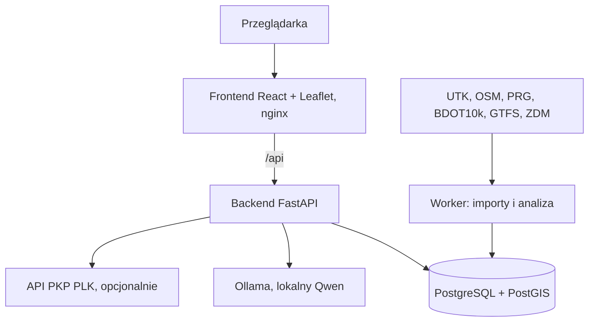

# Architektura techniczna

Stan na wersję 1.0.0. Schemat bazy i reguły danych: [DATA_CONTRACT.md](DATA_CONTRACT.md); źródła: [DATA_SOURCES.md](DATA_SOURCES.md); metoda RPS: [ANALYSIS_METHOD.md](ANALYSIS_METHOD.md); asystent: [ASSISTANT_CAPABILITIES.md](ASSISTANT_CAPABILITIES.md); interfejs: [FRONTEND_DESIGN.md](FRONTEND_DESIGN.md).

## System

Worker uruchamia się ręcznie i zapisuje dane oraz przebiegi analizy w bazie. Backend tylko czyta: ewidencję, ostatni zakończony przebieg analizy i dane PKP PLK. Asystent wybiera funkcje z listy dozwolonych, a backend wykonuje ich zapytania i buduje dane do odpowiedzi. Frontend nie zna żadnych kluczy.

## Usługi Docker Compose
| Usługa | Rola | Dostęp z hosta |
|---|---|---|
| `postgis` | baza z trwałym wolumenem | `127.0.0.1:${POSTGIS_HOST_PORT:-55432}` |
| `migrate` | `alembic upgrade head` przy starcie, potem kończy pracę | — |
| `backend` | FastAPI | `127.0.0.1:${BACKEND_HOST_PORT:-8765}` |
| `frontend` | aplikacja statyczna i proxy `/api` w nginx | `127.0.0.1:${FRONTEND_HOST_PORT:-8080}` |
| `ollama` | lokalny model, wolumen modeli | brak portu |
| `ollama-pull` | jednorazowe pobranie `OLLAMA_MODEL` | — |
| `worker` | zadania importu i analizy (profil `jobs`, `docker compose run --rm worker …`) | raporty w `./reports` |

Wszystkie usługi są w prywatnej sieci `railsafe`. Karta NVIDIA dla modelu: dodatek `docker-compose.gpu.yml`. Migracje cofa się wyłącznie ręcznie.

## Zadania workera
| Polecenie | Zakres |
|---|---|
| `import-crossings` | ewidencja przejazdów z warstwy UTK, kontrola w OSM, raport audytu |
| `import-topology` | dzielnice (PRG), tory i jezdnie (BDOT10k), weryfikacja geometryczna |
| `import-schedule` | planowy ruch pociągów z GTFS, także rozkład w ciągu doby |
| `import-road-counts` | pomiary ZDM w punktach APR |
| `import-intersection-counts` | pomiary ZDM na skrzyżowaniach (karta i raport, bez wpływu na RPS) |
| `run-analysis` | wskaźnik RPS, ranking, analiza wrażliwości, raport |
| `load-demo` | syntetyczny zestaw demonstracyjny bez internetu |

Importy, które pobierają dane z sieci, przyjmują też zapisane wcześniej odpowiedzi (`--osm-file`, pliki JSON ZDM), żeby dało się je powtórzyć bez dostępu do źródła.

## Baza danych
Schematy: `system` (źródła, licencje, zadania importu, flagi jakości), `spatial` (dzielnice, przejazdy, odcinki torów i dróg z relacjami M:N), `rail` (zdarzenia rozkładowe i wykonane, ruch przez przejazd), `road` (punkty pomiarowe, pomiary, dopasowanie do przejazdów), `safety` (cechy przejazdów, zdarzenia SEWiK), `analysis` (przebiegi, wyniki, składniki). Geometrie w EPSG:2180. Migracje Alembic 0001–0010 w jawnym SQL, każda z działającym `downgrade`, sprawdzanym w CI.

## API
Wszystkie ścieżki z prefiksem `/api/v1`. Pełny kontrakt: `http://127.0.0.1:8765/docs` (OpenAPI).

| Endpoint | Zawartość |
|---|---|
| `GET /health` | wersja, tryb demo, stan bazy (rewizja schematu) i modelu |
| `GET /districts` | granice dzielnic (GeoJSON) |
| `GET /crossings` | ewidencja z filtrami dzielnicy, obszaru (`bbox`), kategorii i statusu weryfikacji; `limit` do 500 |
| `GET /crossings/{id}` | karta przejazdu: atrybuty, ruch kolejowy i drogowy, składniki RPS, źródła |
| `GET /analysis/latest` | ostatni zakończony przebieg analizy |
| `GET /incidents` | historia zdarzeń SEWiK, opcjonalnie dla jednego przejazdu (`crossing_id`) |
| `GET /rail/status`, `/stations`, `/operations`, `/disruptions`, `/schedules` | odczyt z API PKP PLK z pamięcią podręczną w procesie i lokalnym limitem zapytań, bez zapisu na dysku; `status` pokazuje, czy klucz jest ustawiony, pozostałe bez klucza zwracają 503 |
| `POST /assistant/chat` | pytanie do asystenta |

Miary w odpowiedziach mają wartość, jednostkę, okres, źródło, metodę i status jakości. Prędkość i natężenie ruchu nie są mieszane.

## Asystent AI
`POST /assistant/chat` przyjmuje `message` (do 500 znaków), `history` (do 8 wiadomości `user`/`assistant`), opcjonalny `crossing_id` dołączonego przejazdu i `analysis_crossing_ids` (do 15 przejazdów z ostatniej analizy w rozmowie). Zwraca `answer`, `model`, `grounded`, `tool_calls`, `disclaimer` i `evidence`.

- Model: `OLLAMA_MODEL` (domyślnie `qwen3:4b-instruct`) przez `/api/chat` Ollamy, bez strumieniowania, limit czasu 240 s. Rozumowanie modeli „thinking” jest oddzielane i nie trafia do odpowiedzi. Dane nie opuszczają komputera.
- Funkcje tylko do odczytu w `backend/app/assistant/tools.py`: `get_ranking`, `get_crossing`, `compare_crossings`, `get_data_quality`, `list_districts`, `get_method`. Argumenty są walidowane; nieznana funkcja lub błędny argument wraca do modelu jako błąd.
- Najwyżej 4 rundy wywołań; w ostatniej model musi odpowiedzieć tekstem. `grounded = true` tylko po co najmniej jednym udanym wywołaniu.
- Dołączony przejazd jest odczytywany z bazy przed zapytaniem do modelu i przekazywany jako zaufany wynik, a nie jako funkcja do swobodnego wywołania.
- `evidence` (karty, tabele, wykresy, źródła, akcja mapy) buduje `assistant/presentation.py` z wyników funkcji. Identyfikatory i liczby nie są wyciągane z tekstu modelu.
- Proste powitania i podziękowania obsługuje `assistant/smalltalk.py` bez wywołania modelu.
- Gdy Ollama nie odpowiada lub model nie jest pobrany, endpoint zwraca 503; mapa i ranking działają dalej.

Zachowanie z punktu widzenia użytkownika: [ASSISTANT_CAPABILITIES.md](ASSISTANT_CAPABILITIES.md).

## Frontend
React i Leaflet, budowany przez Vite i serwowany przez nginx. Historia rozmów, gałęzie, szkice i stan mapy są zapisywane tylko w `localStorage` przeglądarki; backend nie przechowuje sesji. Zatrzymanie odpowiedzi przerywa oczekiwanie w przeglądarce, ale Ollama może dokończyć obliczenia. Szczegóły: [FRONTEND_DESIGN.md](FRONTEND_DESIGN.md).

## Bezpieczeństwo
- Porty tylko na `127.0.0.1`; Ollama bez portu na hoście.
- Klucz PKP PLK tylko w backendzie (`PLK_API_KEY` w `.env`), nigdy w odpowiedziach API ani we frontendzie.
- Model nie generuje SQL; zapytania są stałe i parametryzowane.
- Rola `system` w historii od klienta jest odrzucana; tekst użytkownika nie zmienia zasad asystenta.
- Tekst modelu jest wyświetlany bez surowego HTML.

## Testy i CI
`.github/workflows/ci.yml`: ruff i pytest na PostGIS (z testem cyklu migracji), testy jednostkowe, build i Playwright frontendu, uruchomienie stosu Compose z zestawem demo. Wydania: `.github/workflows/release.yml` i [RELEASE.md](RELEASE.md).
