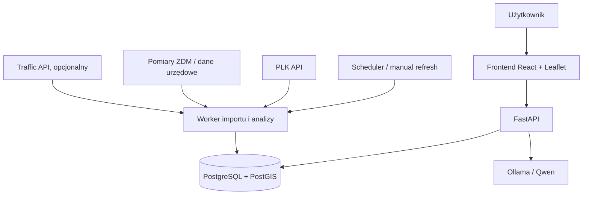

# Architektura techniczna i kontrakty (v1.0)

## System

Ollama interpretuje intencję i zwraca parametry do allowlisty funkcji. Backend sam wykonuje szablony zapytań i zwraca dane, na których oparta jest odpowiedź. Frontend nie zna sekretów API.

## Docker Compose (docelowe serwisy)
- `frontend`: statyczna aplikacja SPA + reverse proxy, http://127.0.0.1:8080.
- `backend`: FastAPI, http://127.0.0.1:8765, tylko loopback.
- `postgis`: PostgreSQL/PostGIS z trwałym named volume, port hosta konfigurowalny (domyślnie 55432, sprawdzić konflikt z GeoGraph).
- `ollama`: lokalny model Qwen, wolumen modeli, bez publicznego portu.
- `worker`: jednorazowe potoki ETL/analiz; `scheduler`: okresowe uruchomienie, bez obowiązkowego brokera w MVP.
- Oddzielne `COMPOSE_PROJECT_NAME`, wolumeny i `.env`; brak automatycznego uruchamiania migracji destrukcyjnych.

## Schematy PostGIS
- `spatial.districts`: district_id, name, teryt, geom(MultiPolygon,2180).
- `spatial.crossings`: crossing_id, official_id(nullable), geom(Point,2180), district_id, category(nullable), verification_status, source_id, verified_at.
- `spatial.rail_segments`, `spatial.road_segments`: odcinki zweryfikowane topologicznie; crossing↔segment jako tabele relacyjne M:N, nie pojedyncze klucze.
- `rail.schedule_events`: source_train_id, station/segment references, planned timestamps, source snapshot id.
- `rail.operation_events`: observed event timestamps, status, references; nie traktować jako surowe GPS.
- `rail.crossing_flow`: crossing_id, period_start/end, count, unit, evidence_type, coverage, method_version.
- `road.measurements`: station_id, segment_id(nullable), period, vehicles_count, direction, source_id, quality.
- `road.live_flow`: wyłącznie dane dozwolone do cache'owania, z expires_at i usuwaniem.
- `safety.crossing_attributes`, `safety.incidents`: kategoria, zabezpieczenia, status pewności, potwierdzone zdarzenia.
- `analysis.runs`, `analysis.risk_scores`, `analysis.components`: snapshot, parametry, wersja modelu, pokrycie, składniki i ranking.
- `system.sources`, `system.import_jobs`, `system.quality_flags`, `system.licenses`: lineage, błędy, reguły retencji.

## API (proponowany kontrakt v1)
- `GET /api/v1/health`
- `GET /api/v1/districts`
- `GET /api/v1/crossings?district_id=&bbox=&verification_status=&limit=&offset=`
- `GET /api/v1/crossings/{id}`
- `GET /api/v1/analyses/ranking?district_id=&period_start=&period_end=&limit=`
- `GET /api/v1/analyses/{run_id}/explanation/{crossing_id}`
- `GET /api/v1/analyses/{run_id}/chart?metric=`
- `POST /api/v1/assistant/query` → {intent, filters, answer, references, map_action, result_ids, warnings}
- `POST /api/v1/admin/refresh`: tylko lokalnie i z kontrolą uprawnień.

## Kontrakt jakości odpowiedzi
Każda miara: `value`, `unit`, `period_start/end`, `observed_at`, `source_id`, `method`, `quality_status`, `coverage_pct` (gdy możliwe). Nie mieszać prędkości (km/h) z natężeniem (pojazdy/h).

## AI
Schemat JSON intencji: `ranking|filter|compare|explain|timeseries`; `district_ids`, `period`, `crossing_ids`, `limit`. Walidator Pydantic i allowlista funkcji. Po błędzie modelu: UI ma umożliwiać te same akcje formularzem. Testy na prompt injection, błędne dzielnice, nieistniejące przejazdy i wymuszanie SQL.

## Strategia obliczeń
Precompute analiz bazowych i cyklicznych w workerze; odświeżanie danych „na żądanie” przez kontrolowany job. Odpowiedzi UI korzystają z ostatniego ukończonego run; nie z częściowo przeliczonego zestawu.

## Asystent AI — implementacja (RSA-013, 2026-11-12)
- **Endpoint:** `POST /api/v1/assistant/chat` z polami `message` (do 500 znaków) i `history` (do 8 wiadomości `user`/`assistant`). Odpowiedź: `answer`, `model`, `grounded`, `tool_calls`, `disclaimer`.
- **Model:** lokalny Qwen przez Ollama (`/api/chat`, bez strumieniowania, temperatura 0,1). Jeśli model ma tryb rozumowania (np. `qwen3:4b` rozumuje zawsze), aplikacja prosi Ollamę o oddzielenie rozumowania i pokazuje tylko odpowiedź; ucięte rozumowanie nigdy nie jest pokazywane jako odpowiedź. Żadne dane nie wychodzą poza komputer.
- **Bezpieczne funkcje** (`backend/app/assistant/tools.py`), wyłącznie odczyt z ostatniego zakończonego przebiegu analizy: `get_ranking`, `get_crossing`, `compare_crossings`, `list_districts`, `get_method`. Model nie pisze SQL i nie ma dostępu do bazy; może tylko wybrać funkcję z listy, a argumenty są walidowane. Nieznana funkcja lub złe argumenty wracają do modelu jako błąd.
- **Pętla:** najwyżej cztery rundy wywołań funkcji; w ostatniej rundzie model nie dostaje funkcji i musi odpowiedzieć tekstem. Pusta odpowiedź jest zastępowana komunikatem zastępczym.
- **Uziemienie:** `grounded = true` tylko wtedy, gdy co najmniej jedno wywołanie funkcji się powiodło. Interfejs pokazuje, jakie dane zostały sprawdzone, a przy `grounded = false` ostrzega, że odpowiedź nie opiera się na danych aplikacji.
- **Zasady w komunikacie systemowym:** odpowiedzi tylko z wyników funkcji, jawne „brak danych", RPS jako priorytet oceny (nie prognoza), pytania spoza zakresu są odrzucane, tekst użytkownika nie zmienia zasad. Rola `system` w historii od klienta jest odrzucana.
- **Niedostępność:** gdy Ollama nie odpowiada lub model nie jest pobrany, endpoint zwraca 503 z czytelnym komunikatem; mapa i ranking działają niezależnie.
- **Ograniczenia:** jakość odpowiedzi zależy od małego modelu (4 mld parametrów) — może źle dobrać funkcję albo niedokładnie streścić wynik. Na komputerze bez GPU odpowiedź może trwać minutę lub dłużej.
